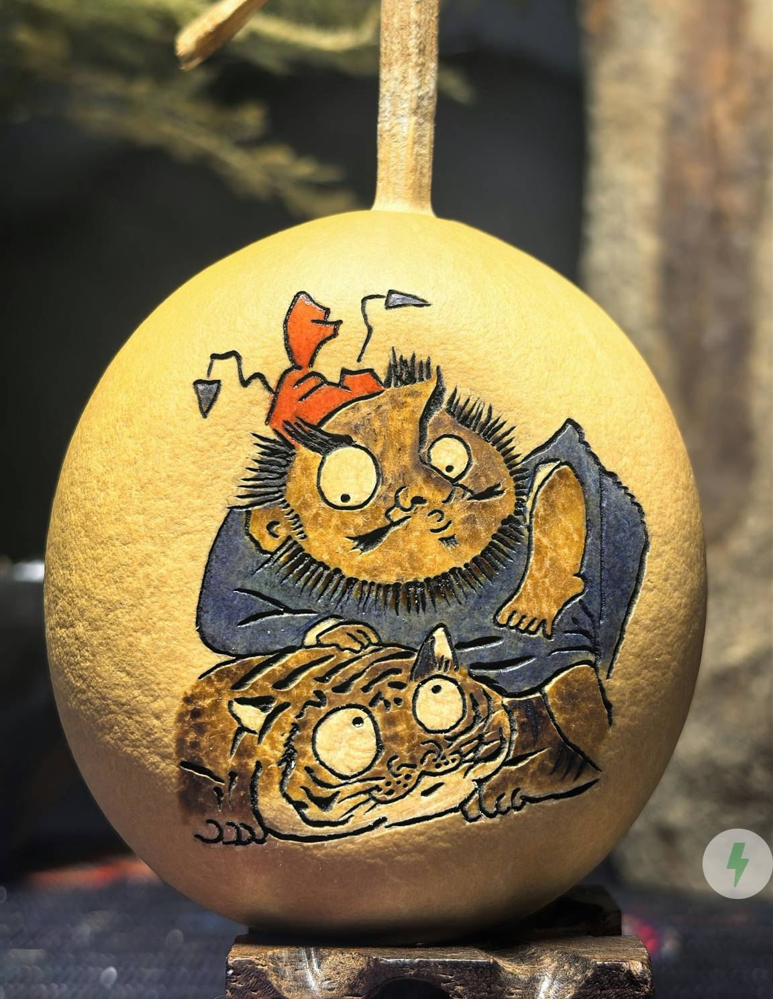
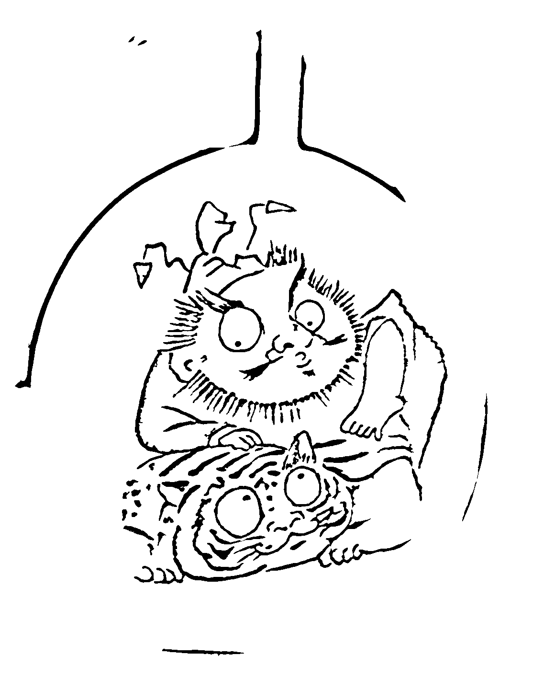
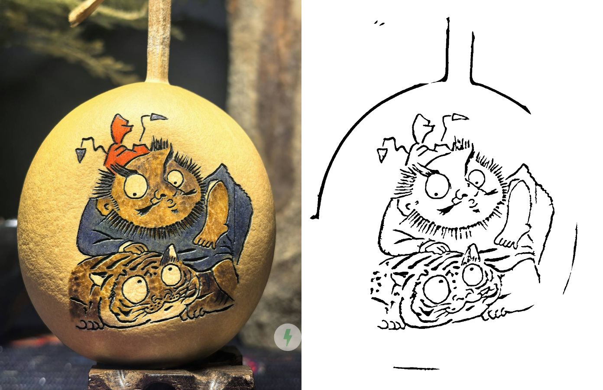

# 纹身线稿大师 · Tattoo Stencil Maker

把彩色 / 黑白图案照片**一键**转成「纯白底 + 纯黑线」的线描稿，直接拿去纹身转印打印机出底稿。

一款离线、无广告、无网络权限、无第三方库的 Android 小工具。导入图片 → 自动生成 → 拖动对比 → 保存 PNG，全程不需要调参数。

---

## 效果

| 原图（彩色烙画 / 葫芦） | 自动生成的线描稿 |
| --- | --- |
|  |  |



参考样图（人工绘制的线稿）：[samples/02-reference.jpg](samples/02-reference.jpg)

输出是**只有 0 和 255 两种灰度值**的二值图，没有灰阶、没有网点、底色纯白，热敏转印机可以直接打印。

---

## 功能

- **傻瓜式**：打开 App → 点「选择图片」→ 自动出稿，默认参数即可用；高级设置默认收起。
- **图片对比**：可拖动的分割线左右对比原图 / 线稿，也支持一键切换「原图 / 线稿 / 对比」三种视图；双指缩放、单指平移看细节。
- **干净底稿**：自动抹平彩色色块、载体表面纹理、虚化背景和桌面，并清理孤立杂点。
- **适合转印**：输出无损 PNG，纯黑线 + 纯白底，写入系统相册 `Pictures/TattooStencil`。
- **可微调**（可选）：细线 / 标准 / 浓线三档预设、线条强度滑块、深色背景净化开关。
- **隐私**：所有计算在本机完成，App 不申请网络权限，不上传任何图片。

---

## 安装使用

1. 下载 [apk/TattooStencil-v1.0.0.apk](apk/TattooStencil-v1.0.0.apk)（约 37 KB），在手机上点击安装。
   - Android 7.0 及以上；安装时系统可能提示「未知来源」，允许即可。
2. 打开 App，点 **① 选择图片**，从相册选一张图案照片。
3. 等待 1～3 秒自动出稿，自动进入对比视图；拖动中间分割线查看效果。
4. 点 **② 保存 PNG**；也可点「分享」直接发给打印机 App 或微信。文件保存在 `相册 / Pictures / TattooStencil`。

> 拍照建议：光线均匀、图案正对镜头、尽量避免强反光与阴影。原图里勾线越深越清晰，出稿效果越好。

---

## 算法原理

处理管线全部用 Java 手写，不依赖 OpenCV / NDK / RenderScript（见 `StencilProcessor.java`）：

1. **等比缩放**到最长边 1440，控制内存与耗时。
2. **灰度 + 轻度方框模糊**，压掉纸张 / 葫芦 / 木料表面的高频颗粒纹理。
3. **背景漂白**：用大尺度局部亮度估计生成掩模，把大片深色背景统一漂白成 255。背景因此不含任何纹理，同时主体与白底形成强边界，外形轮廓能被完整提取。
4. **局部均值差分** `(局部均值 − 当前灰度)` 提取「比周围暗的细结构」，即深色勾线。大面积色块因为局部均值同样偏低而不产生响应，**自动变成白底**。
5. **亮度门控 × 背景掩模**，压制深色背景里的杂散响应。
6. **多通道 Sobel 边缘融合**，补齐主体外形轮廓（包括亮度接近但颜色不同的边界）。
7. **高分位归一化 + 固定阈值二值化** → 纯黑线。
8. **连通域清理**：删除孤立碎点，以及「贴画面边缘且尺寸较小」的水印、底座、背景残影；中心区域的细节与长线条全部保留。
9. 输出 `ARGB_8888`，像素只有 `0xFF000000`（黑）与 `0xFFFFFFFF`（白）。

`scripts/preview.py` 是与 Java 实现逐步骤等价的 Python 参考实现，可在电脑上无 Android 环境时复现输出、调参或批量处理：

```bash
python3 -m pip install numpy opencv-python
python3 scripts/preview.py samples/01-input.jpg out.png
```

---

## 项目结构

```
app/src/main/
├── java/com/donghuaigu/stencil/
│   ├── MainActivity.java        一键选图 / 处理 / 保存 / 分享
│   ├── StencilProcessor.java    线描提取核心算法（纯 Java）
│   └── CompareView.java         拖动分割对比 + 缩放平移
├── res/                        布局、样式、图标
└── AndroidManifest.xml
scripts/
├── build-apk.sh                不依赖 Gradle 的轻量构建脚本
└── preview.py                  桌面端参考实现 / 效果预览
samples/                        原图、参考线稿、输出与对比图
apk/                            已签名可安装的 APK
```

## 自行构建

### 方式 A：Android Studio（标准 Gradle 工程）

用 Android Studio 打开仓库根目录，`Build > Generate Signed Bundle / APK` 或直接 Run 即可。仅使用 Android framework API，无 AndroidX 依赖。

### 方式 B：命令行轻量构建

需要 Android SDK 的 `platforms;android-35` 与 `build-tools;35.0.0`：

```bash
export ANDROID_SDK_ROOT=/path/to/android-sdk
bash scripts/build-apk.sh
```

脚本依次完成 `aapt2 compile/link → javac → d8 → zipalign → apksigner`，并自动生成临时签名密钥，产物在 `apk/`。

---

## 已知限制

- 若原图中主体外形与背景**亮度和颜色都很接近**（例如样图中葫芦下半部与深色木座相接），外轮廓可能不完整；这是原图缺少可提取边界所致，可先裁图或提高对比度再导入。
- 算法针对「浅色载体上的深色勾线」图案优化。纯色块插画、无勾线的写实照片建议先用「浓线」预设并调高强度。
- 输出为二值图，不做灰度抗锯齿，这是转印底稿的有意设计。

## 开源协议

[MIT](LICENSE) — 可自由使用、修改、商用。
